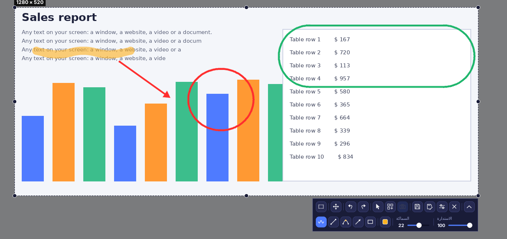
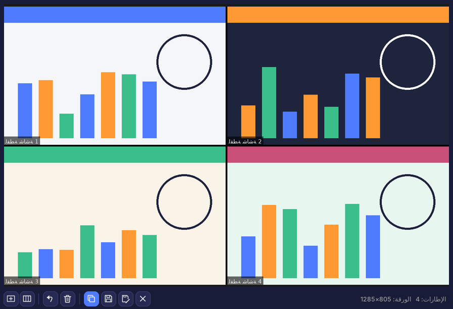
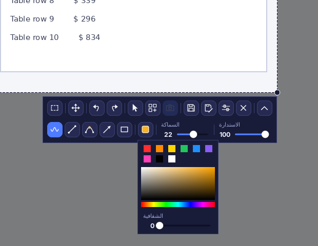
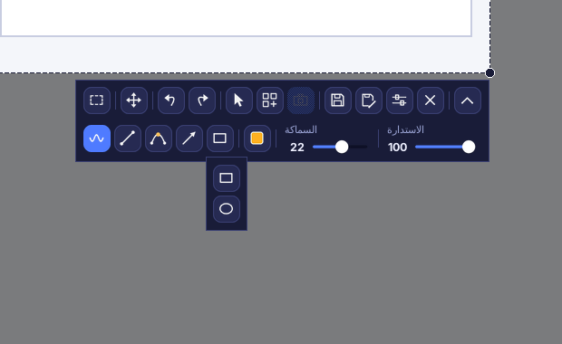
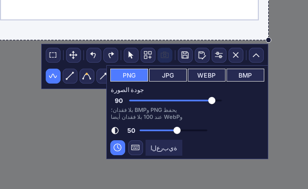
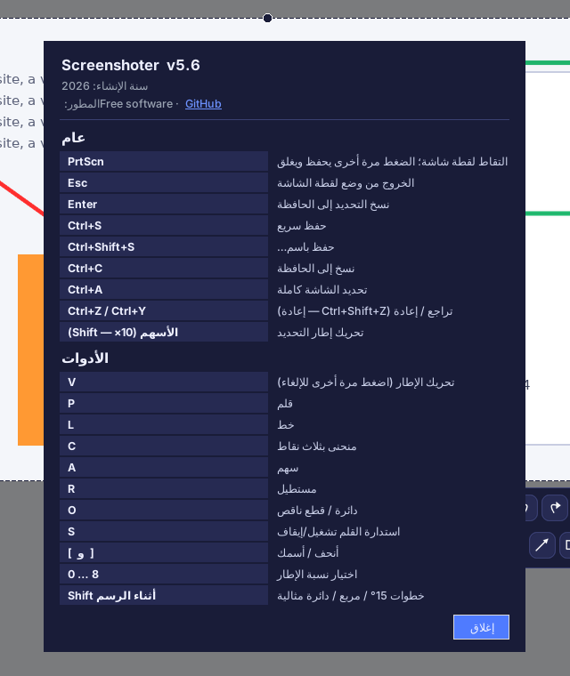

# Screenshoter (سكرينشوتر)

[English](README.md) · [Русский](README.ru.md) · [Español](README.es.md) · [Deutsch](README.de.md) · [Français](README.fr.md) · [Português](README.pt.md) · [中文](README.zh.md) · [日本語](README.ja.md) · [हिन्दी](README.hi.md) · **العربية**

**Screenshoter** برنامج سريع للقطات الشاشة على Windows على غرار Lightshot: اضغط **PrtScn**، حدّد منطقة، ارسم فوقها أسهمًا وإطارات وملاحظات، ثم احفظ أو انسخ. واجهة داكنة حديثة، ويعمل من شريط النظام. الواجهة متوفرة بـ 10 لغات.

## المزايا

- **تحديد المنطقة** بمقابض على الحواف والزوايا؛ ويتذكر الإطار موضعه.
- **النسب**: حرة، 1:1، 4:5، 3:4، 4:3، 16:9، 9:16، 3:2، 2:3، نسبة مخصّصة أو حجم دقيق بالبكسل.
- **الرسم**: قلم، خط، منحنى بثلاث نقاط، سهم، مستطيل، دائرة وقطع ناقص؛ اللون والشفافية والسماكة والاستدارة؛ تراجع وإعادة.
- يمكن تضمين **مؤشر الفأرة** في لقطة الشاشة.
- **الحفظ** بصيغ PNG وJPG وWEBP وBMP مع التحكم بالجودة؛ والنسخ إلى الحافظة.
- **الالتقاط عند الحفظ**: لا تتجمّد الشاشة ويستمر الفيديو، وتُلتقط الصورة لحظة الحفظ.
- **الكولاج**: عدة إطارات في ورقة واحدة — راجع القسم المخصّص أدناه.
- شاشات متعددة وتكبير Windows من 125 إلى 200 %.
- **10 لغات للواجهة**: Русский, English, Español, Deutsch, Français, Português, 中文, 日本語, हिन्दी, العربية (من الإعدادات).

## وضع الكولاج

اجمع عدة أجزاء من الشاشة في **ورقة واحدة** — لشرح تعليمي أو تقرير عن خطأ أو مقارنة قبل/بعد أو منشور. تبقى الشاشة حيّة أثناء العمل، فيمكنك تمرير صفحة أو تشغيل فيديو ومواصلة التقاط الإطارات.

1. افتح لقطة شاشة (**PrtScn**)، حدّد منطقة واضغط زر **الكولاج** في الشريط. لا تتجمّد الشاشة بل تبقى حيّة.
2. حرّك الإطار أو غيّر حجمه ثم اضغط زر **الإطار** (أو **PrtScn** / **Enter**) لالتقاط المنطقة. كرّر ذلك قدر ما تشاء.
3. تجمع نافذة الكولاج الإطارات في شبكة، لكل إطار عنوان «لقطة شاشة N» وتفصل بينها حدود سوداء. اختر **نسبة الخلية** (تلقائي، 1:1، 16:9، مخصّص…) و**عدد الأعمدة**.
4. **احفظ** الورقة (PNG وJPG وWEBP وBMP) أو **احفظ باسم…** أو **انسخها** إلى الحافظة، وتراجع عن آخر إطار، أو امسح الكل، أو صغّر النافذة وواصل الالتقاط.
5. الخروج من وضع الكولاج بزره يحذف الإطارات الملتقطة.

## الواجهة

الصف العلوي: النسب، تحريك الإطار، تراجع وإعادة، المؤشر في اللقطة، الكولاج، إطار الكولاج، حفظ، حفظ باسم، الإعدادات، إغلاق. الصف السفلي (يُفتح بزر السهم): القلم، الخط، المنحنى، السهم، الأشكال، اللون، السماكة، الاستدارة. لا تُفعَّل أي أداة تلقائيًا؛ والضغط على الأداة النشطة مرة أخرى يوقفها. يظهر مؤشر التصويب أثناء الرسم فقط.

### اللون والشفافية

ألوان سريعة ولوحة ألوان ومنزلق لشفافية الخط.

### الأشكال

### الإعدادات

الصيغة والجودة، والتعتيم خارج الإطار، و«الالتقاط عند الحفظ» (الساعة)، والاختصارات (لوحة المفاتيح)، واختيار اللغة.

### الاختصارات وحول البرنامج

## التثبيت

1. ثبّت Python 3.9 أو أحدث من python.org (فعّل «Add Python to PATH»).
2. شغّل `install.bat` — يثبّت Pillow وpystray وpynput، ومعها arabic-reshaper وpython-bidi لعرض العربية.
3. شغّل `run.bat`. تظهر أيقونة في شريط النظام؛ والتقط لقطة بالمفتاح **PrtScn**.
4. للحصول على ملف `.exe` واحد لا يحتاج Python شغّل `build_exe.bat`؛ والنتيجة في المجلد `dist`.

> التشغيل التلقائي: انقر بزر الفأرة الأيمن على أيقونة الشريط ← «التشغيل مع Windows». في Windows 11 يفتح PrtScn أداة القصاصات افتراضيًا: عطّل ذلك من الإعدادات ← إمكانية الوصول ← لوحة المفاتيح.

## التطوير

Python 3 وTkinter وPillow وpystray وpynput. الشيفرة المصدرية: `screenshoter.py` و`i18n_data.py` (الترجمات).

سنة الإنشاء: 2026. المطوّر: Free software · [GitHub](https://github.com/Al235r/Screenshoter).
