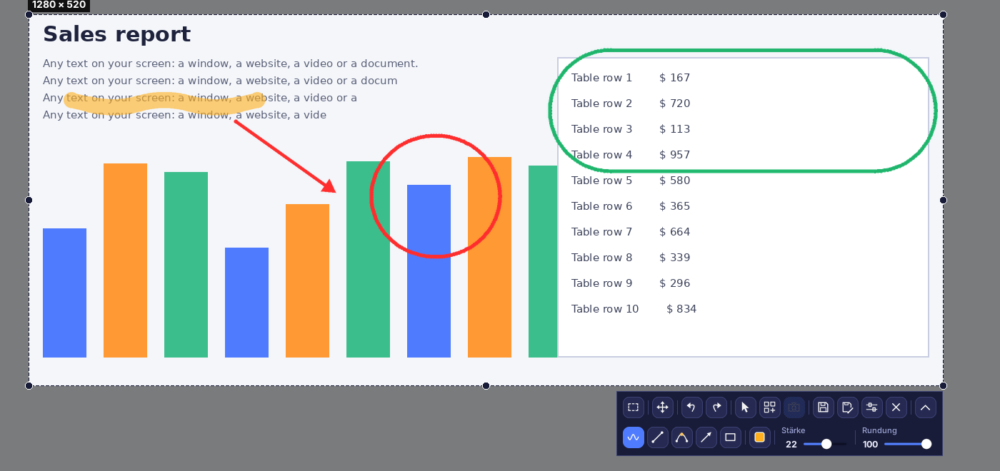
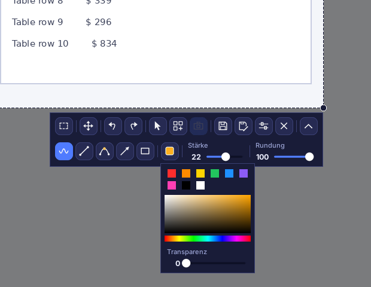
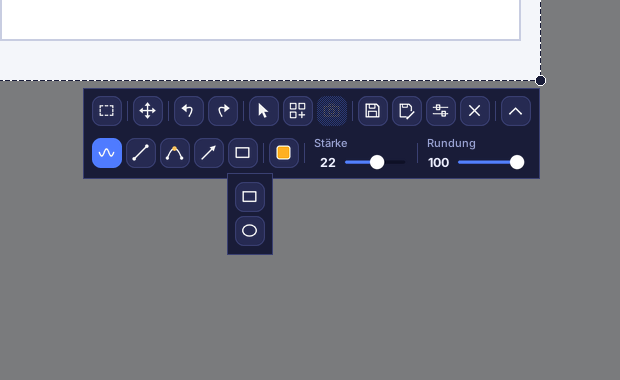
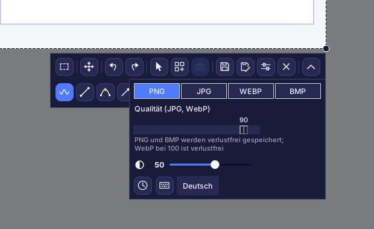
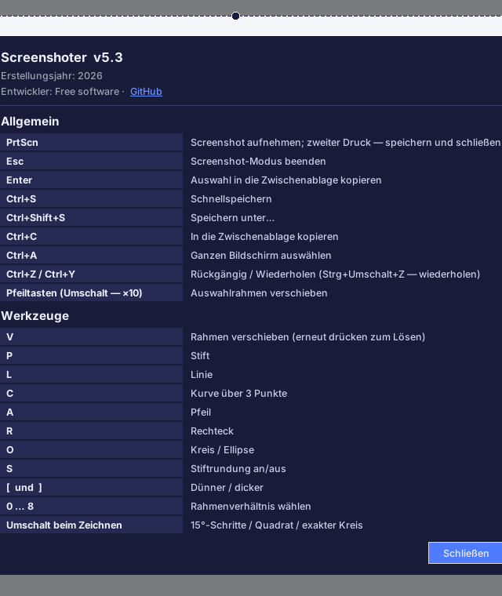

# Screenshoter

[Русский](README.md) · [English](README.en.md) · [Español](README.es.md) · **Deutsch** · [Français](README.fr.md) · [Português](README.pt.md) · [中文](README.zh.md) · [日本語](README.ja.md)

**Screenshoter** ist ein schnelles Screenshot-Programm für Windows im Stil von Lightshot: **PrtScn** drücken, Bereich auswählen, Pfeile, Rahmen und Notizen darüber zeichnen, speichern oder kopieren. Modernes dunkles Design, läuft im Infobereich der Taskleiste. Die Oberfläche gibt es in 8 Sprachen.

## Funktionen

- **Bereichsauswahl** mit Griffen an Kanten und Ecken; der Rahmen merkt sich seine Position.
- **Seitenverhältnisse**: frei, 1:1, 4:5, 3:4, 4:3, 16:9, 9:16, 3:2, 2:3, ein eigenes Verhältnis oder eine exakte Größe in Pixeln.
- **Zeichnen**: Stift, Linie, 3-Punkt-Kurve, Pfeil, Rechteck, Kreis und Ellipse; Farbe, Transparenz, Stärke, Rundung; Rückgängig und Wiederholen.
- Der **Mauszeiger** kann in den Screenshot übernommen werden.
- **Speichern** als PNG, JPG, WEBP oder BMP mit Qualitätsregler; Kopieren in die Zwischenablage.
- **Aufnahme beim Speichern**: Der Bildschirm wird nicht eingefroren, Videos laufen weiter, das Bild entsteht beim Speichern.
- **Collage**: Live-Modus, Bilder mit der Beschriftung „Screenshot N“, schwarze Ränder, Abdunklung außerhalb des Rahmens.
- Mehrere Monitore und Windows-Skalierung von 125–200 %.
- **8 Oberflächensprachen**: Русский, English, Español, Deutsch, Français, Português, 中文, 日本語 (Auswahl in den Einstellungen).

## Oberfläche

Obere Reihe: Seitenverhältnis, Rahmen verschieben, Rückgängig und Wiederholen, Zeiger im Screenshot, Collage, Collage-Bild, Speichern, Speichern unter, Einstellungen, Schließen. Untere Reihe (über den Pfeil-Button ein- und ausblendbar): Stift, Linie, Kurve, Pfeil, Formen, Farbe, Stärke, Rundung. Kein Werkzeug schaltet sich von selbst ein; erneutes Klicken schaltet es aus. Das Fadenkreuz erscheint nur während des Zeichnens.

### Farbe und Transparenz

Schnellfarben, Palette und ein Regler für die Linientransparenz.

### Formen

### Einstellungen

Format und Qualität, Abdunklung außerhalb des Rahmens, „Aufnahme beim Speichern“ (Uhr), Tastenkürzel (Tastatur) und Sprachauswahl.

### Tastenkürzel und Info

## Installation

1. Python 3.9 oder neuer von python.org installieren („Add Python to PATH“ ankreuzen).
2. `install.bat` ausführen — es installiert Pillow, pystray und pynput.
3. `run.bat` ausführen. Ein Symbol erscheint im Infobereich; Screenshot mit **PrtScn**.
4. Für eine einzelne `.exe` ohne Python `build_exe.bat` ausführen; das Ergebnis liegt in `dist`.

> Autostart: Rechtsklick auf das Symbol im Infobereich → „Mit Windows starten“. Unter Windows 11 öffnet PrtScn standardmäßig das Snipping Tool: Das lässt sich unter Einstellungen → Barrierefreiheit → Tastatur abschalten.

## Entwicklung

Python 3, Tkinter, Pillow, pystray, pynput. Quellcode: `screenshoter.py` und `i18n_data.py` (Übersetzungen).

Erstellungsjahr: 2026. Entwickler: Free software · [GitHub](https://github.com/Al235r/Screenshoter).
