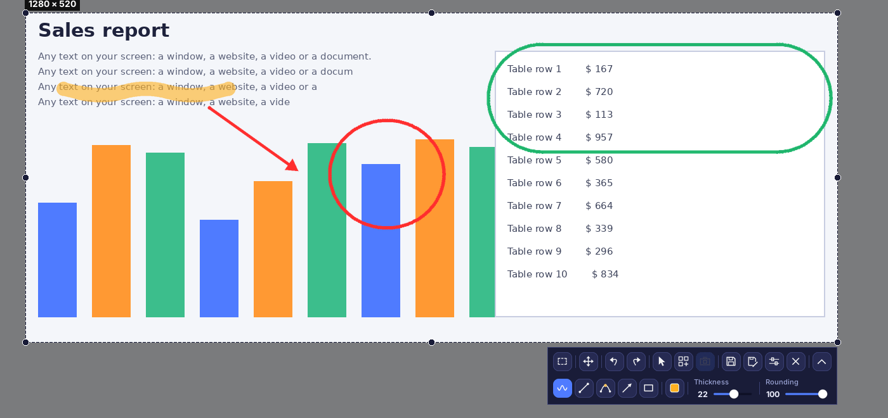
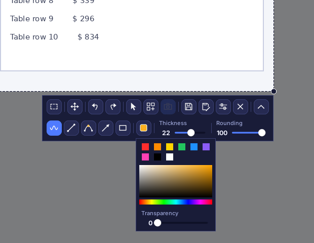
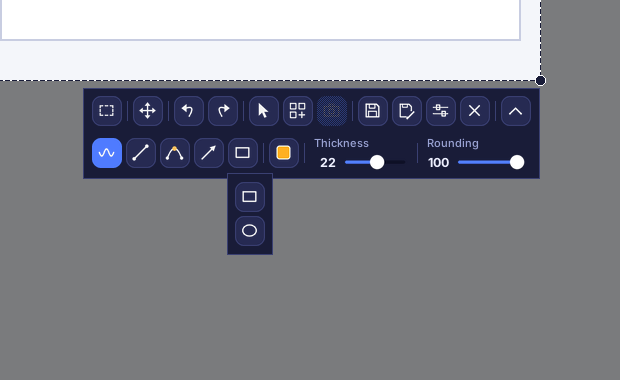
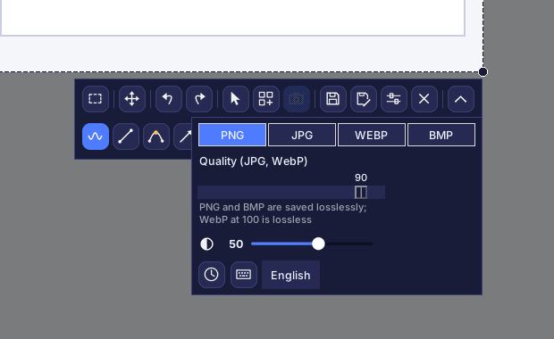
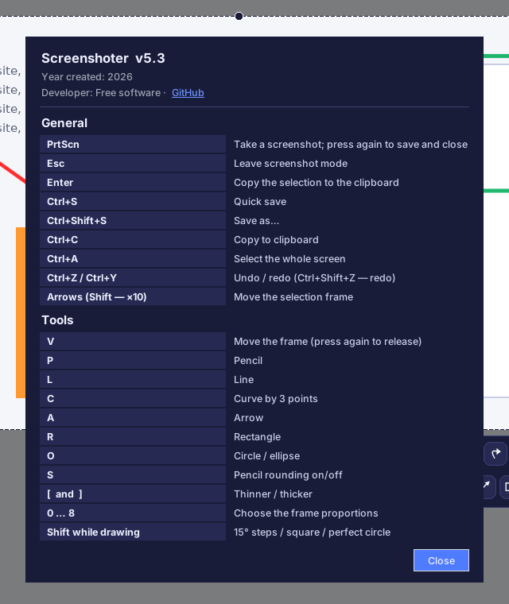

# Screenshoter

[Русский](README.md) · **English** · [Español](README.es.md) · [Deutsch](README.de.md) · [Français](README.fr.md) · [Português](README.pt.md) · [中文](README.zh.md) · [日本語](README.ja.md)

**Screenshoter** is a fast Windows screenshot tool in the spirit of Lightshot: press **PrtScn**, select an area, draw arrows, frames and notes on top, then save or copy. Modern dark interface, lives in the system tray. The interface is available in 8 languages.

## Features

- **Area selection** with handles on edges and corners; the frame remembers its position.
- **Aspect ratios**: free, 1:1, 4:5, 3:4, 4:3, 16:9, 9:16, 3:2, 2:3, a custom ratio or an exact size in pixels.
- **Drawing**: pencil, line, 3-point curve, arrow, rectangle, circle and ellipse; color, transparency, thickness, rounding; undo and redo.
- The **mouse cursor** can be included in the screenshot.
- **Saving** as PNG, JPG, WEBP or BMP with quality control; copy to the clipboard.
- **Capture on save**: the screen is not frozen, video keeps playing, the picture is taken when you save.
- **Collage**: live mode, frames captioned “Screenshot N”, black borders, dimming outside the frame.
- Multiple monitors and Windows scaling of 125–200 %.
- **8 interface languages**: Русский, English, Español, Deutsch, Français, Português, 中文, 日本語 (choose in Settings).

## Interface

Top row: proportions, move the frame, undo and redo, cursor in the screenshot, collage, collage frame, save, save as, settings, close. Bottom row (toggled by the arrow button): pencil, line, curve, arrow, shapes, color, thickness, rounding. No tool turns on by itself; pressing an active tool again turns it off. The crosshair appears only while you draw.

### Color and transparency

Quick colors, a palette and a line-transparency slider.

### Shapes

### Settings

Format and quality, dimming outside the frame, “Capture on save” (clock), hotkeys (keyboard) and language selection.

### Hotkeys and about

## Installation

1. Install Python 3.9 or newer from python.org (tick “Add Python to PATH”).
2. Run `install.bat` — it installs Pillow, pystray and pynput.
3. Run `run.bat`. A tray icon appears; take a screenshot with **PrtScn**.
4. For a single `.exe` that needs no Python, run `build_exe.bat`; the result is in `dist`.

> Autostart: right-click the tray icon → “Start with Windows”. On Windows 11 PrtScn opens the Snipping Tool by default: turn that off in Settings → Accessibility → Keyboard.

## Development

Python 3, Tkinter, Pillow, pystray, pynput. Source: `screenshoter.py` and `i18n_data.py` (translations).

Year created: 2026. Developer: Free software · [GitHub](https://github.com/Al235r/Screenshoter).
