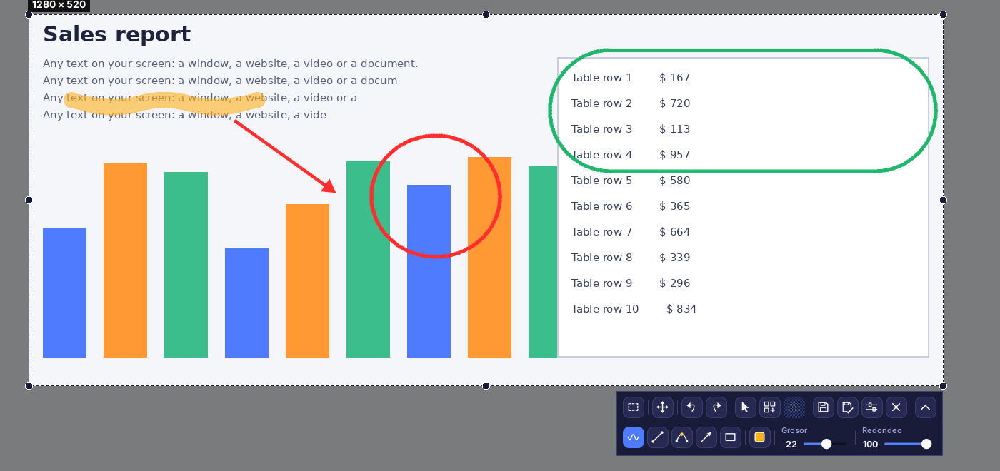
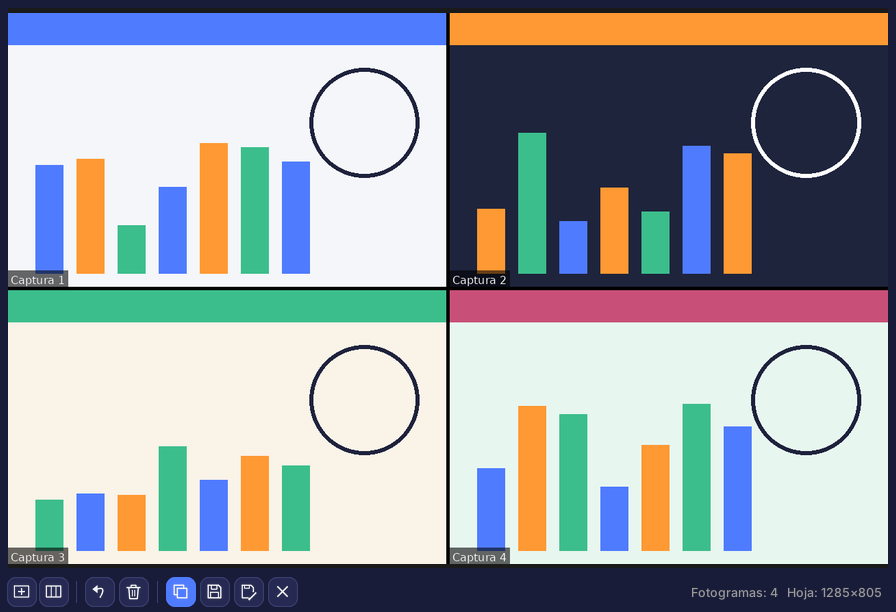
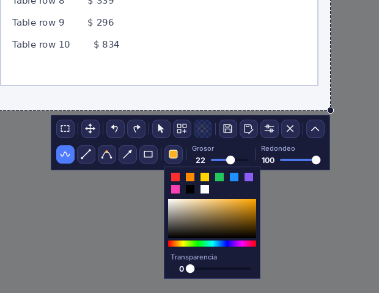
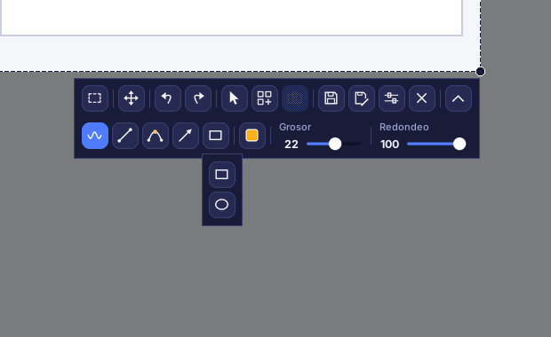
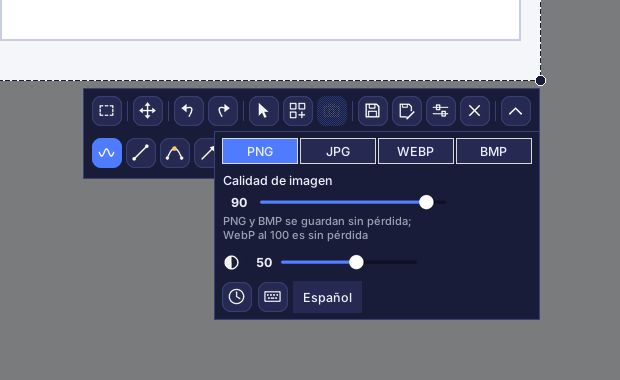
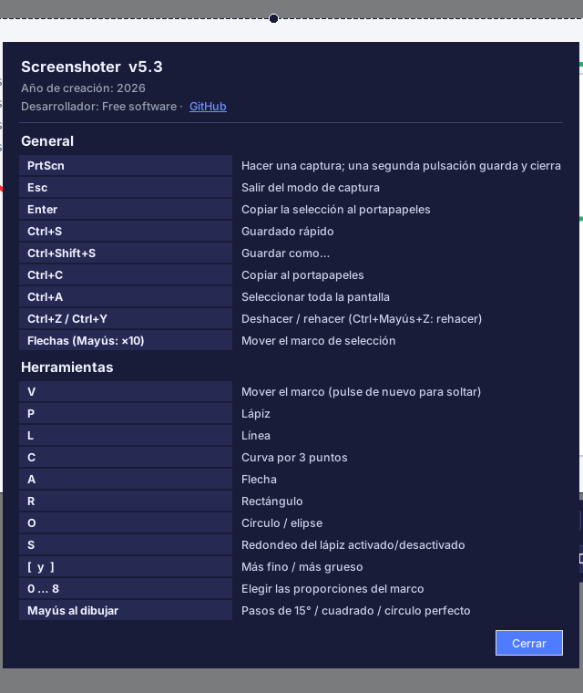

# Screenshoter

[English](README.md) · [Русский](README.ru.md) · **Español** · [Deutsch](README.de.md) · [Français](README.fr.md) · [Português](README.pt.md) · [中文](README.zh.md) · [日本語](README.ja.md) · [हिन्दी](README.hi.md) · [العربية](README.ar.md)

**Screenshoter** es una herramienta rápida de capturas de pantalla para Windows al estilo de Lightshot: pulse **PrtScn**, seleccione un área, dibuje encima flechas, marcos y notas, y guarde o copie. Interfaz oscura moderna, funciona desde la bandeja del sistema. La interfaz está disponible en 10 idiomas.

## Características

- **Selección de área** con tiradores en bordes y esquinas; el marco recuerda su posición.
- **Proporciones**: libre, 1:1, 4:5, 3:4, 4:3, 16:9, 9:16, 3:2, 2:3, una proporción propia o un tamaño exacto en píxeles.
- **Dibujo**: lápiz, línea, curva de 3 puntos, flecha, rectángulo, círculo y elipse; color, transparencia, grosor, redondeo; deshacer y rehacer.
- El **cursor del ratón** puede incluirse en la captura.
- **Guardado** en PNG, JPG, WEBP y BMP con control de calidad; copia al portapapeles.
- **Captura al guardar**: la pantalla no se congela, el vídeo sigue reproduciéndose y la imagen se toma al guardar.
- **Collage**: modo en vivo, fotogramas con el título «Captura N», bordes negros y atenuación fuera del marco.
- Varios monitores y escalado de Windows del 125 al 200 %.
- **10 idiomas de interfaz**: Русский, English, Español, Deutsch, Français, Português, 中文, 日本語, हिन्दी, العربية (se elige en Ajustes).

## Modo collage

Reúna varias partes de la pantalla en **una sola hoja**: para un tutorial, un informe de errores, una comparación antes/después o una publicación. La pantalla sigue activa mientras trabaja, así que puede desplazar una página o reproducir un vídeo y seguir capturando.

1. Abra una captura (**PrtScn**), seleccione un área y pulse el botón de **collage** de la barra. La pantalla no se congela: sigue en vivo.
2. Mueva o redimensione el marco y pulse el botón de **fotograma** (o **PrtScn** / **Enter**) para capturar el área. Repita las veces que necesite.
3. La ventana del collage reúne los fotogramas en una cuadrícula, cada uno con el título «Captura N» y separados por bordes negros. Elija la **proporción de celda** (auto, 1:1, 16:9, personalizada…) y el **número de columnas**.
4. **Guarde** la hoja (PNG, JPG, WEBP, BMP), **Guardar como…**, **cópiela** al portapapeles, deshaga el último fotograma, borre todo o minimice la ventana y siga capturando.
5. Salir del modo collage con su botón descarta los fotogramas capturados.

## Interfaz

Fila superior: proporciones, mover el marco, deshacer y rehacer, cursor en la captura, collage, fotograma del collage, guardar, guardar como, ajustes, cerrar. Fila inferior (se muestra con el botón de flecha): lápiz, línea, curva, flecha, formas, color, grosor, redondeo. Ninguna herramienta se activa sola; pulsar de nuevo una herramienta activa la desactiva. La cruz aparece solo mientras se dibuja.

### Color y transparencia

Colores rápidos, paleta y control deslizante de transparencia de la línea.

### Formas

### Ajustes

Formato y calidad, atenuación fuera del marco, «Captura al guardar» (reloj), atajos de teclado (teclado) y selección de idioma.

### Atajos de teclado y acerca de

## Instalación

1. Instale Python 3.9 o superior desde python.org (marque «Add Python to PATH»).
2. Ejecute `install.bat`: instala Pillow, pystray y pynput.
3. Ejecute `run.bat`. Aparece un icono en la bandeja; haga la captura con **PrtScn**.
4. Para un único `.exe` sin Python, ejecute `build_exe.bat`; el resultado queda en `dist`.

> Inicio automático: clic derecho en el icono de la bandeja → «Iniciar con Windows». En Windows 11 PrtScn abre por defecto la Herramienta Recortes: desactívelo en Configuración → Accesibilidad → Teclado.

## Desarrollo

Python 3, Tkinter, Pillow, pystray, pynput. Código: `screenshoter.py` e `i18n_data.py` (traducciones).

Año de creación: 2026. Desarrollador: Free software · [GitHub](https://github.com/Al235r/Screenshoter).
