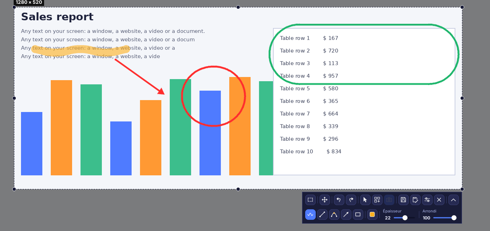
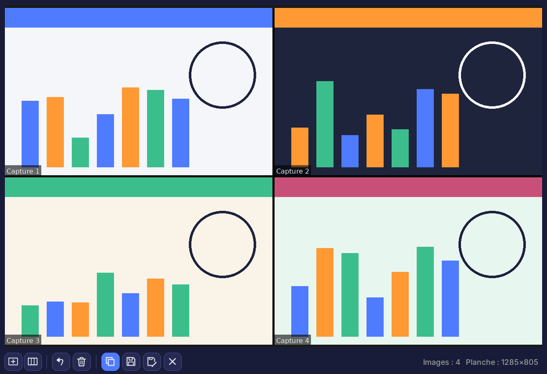
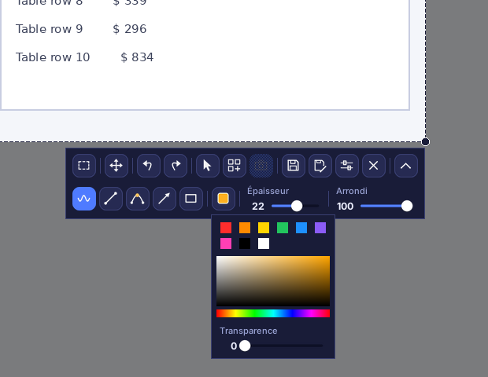
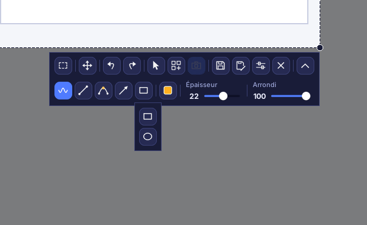
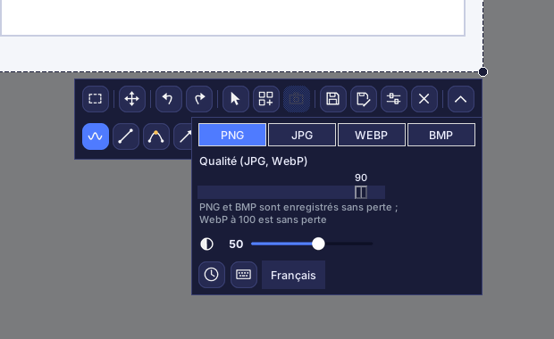
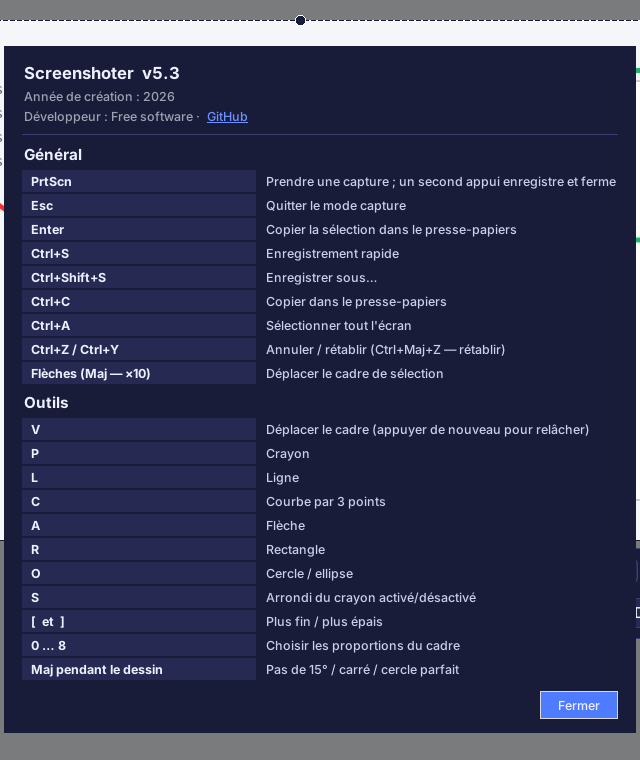

# Screenshoter

[English](README.md) · [Русский](README.ru.md) · [Español](README.es.md) · [Deutsch](README.de.md) · **Français** · [Português](README.pt.md) · [中文](README.zh.md) · [日本語](README.ja.md) · [हिन्दी](README.hi.md) · [العربية](README.ar.md)

**Screenshoter** est un outil de capture d'écran rapide pour Windows, dans l'esprit de Lightshot : appuyez sur **PrtScn**, sélectionnez une zone, dessinez dessus des flèches, des cadres et des notes, puis enregistrez ou copiez. Interface sombre moderne, fonctionne depuis la zone de notification. L'interface existe en 10 langues.

## Fonctionnalités

- **Sélection de zone** avec poignées sur les bords et les coins ; le cadre mémorise sa position.
- **Proportions** : libre, 1:1, 4:5, 3:4, 4:3, 16:9, 9:16, 3:2, 2:3, un rapport personnalisé ou une taille exacte en pixels.
- **Dessin** : crayon, ligne, courbe à 3 points, flèche, rectangle, cercle et ellipse ; couleur, transparence, épaisseur, arrondi ; annuler et rétablir.
- Le **curseur de la souris** peut être inclus dans la capture.
- **Enregistrement** en PNG, JPG, WEBP ou BMP avec réglage de la qualité ; copie dans le presse-papiers.
- **Capture à l'enregistrement** : l'écran n'est pas figé, la vidéo continue, l'image est prise au moment de l'enregistrement.
- **Collage** : mode en direct, images légendées « Capture N », bordures noires, assombrissement hors du cadre.
- Plusieurs écrans et mise à l'échelle Windows de 125 à 200 %.
- **10 langues d'interface** : Русский, English, Español, Deutsch, Français, Português, 中文, 日本語, हिन्दी, العربية (choix dans les Paramètres).

## Mode collage

Rassemblez plusieurs morceaux de l’écran sur **une seule feuille** : pour un tutoriel, un rapport de bug, une comparaison avant/après ou une publication. L’écran reste vivant pendant que vous travaillez : faites défiler une page ou lisez une vidéo tout en continuant à capturer.

1. Ouvrez une capture (**PrtScn**), sélectionnez une zone et cliquez sur le bouton **collage** de la barre. L’écran ne se fige pas : il reste en direct.
2. Déplacez ou redimensionnez le cadre, puis cliquez sur le bouton **image** (ou **PrtScn** / **Entrée**) pour capturer la zone. Répétez autant de fois que nécessaire.
3. La fenêtre du collage dispose les images en grille, chacune légendée « Capture N » et séparée par des bordures noires. Choisissez le **format des cellules** (auto, 1:1, 16:9, personnalisé…) et le **nombre de colonnes**.
4. **Enregistrez** la feuille (PNG, JPG, WEBP, BMP), **Enregistrer sous…**, **copiez**-la dans le presse-papiers, annulez la dernière image, tout effacez ou réduisez la fenêtre et continuez à capturer.
5. Quitter le mode collage avec son bouton supprime les images capturées.

## Interface

Rangée du haut : proportions, déplacer le cadre, annuler et rétablir, curseur dans la capture, collage, image du collage, enregistrer, enregistrer sous, paramètres, fermer. Rangée du bas (affichée par le bouton flèche) : crayon, ligne, courbe, flèche, formes, couleur, épaisseur, arrondi. Aucun outil ne s'active tout seul ; un second clic le désactive. Le réticule n'apparaît que pendant le dessin.

### Couleur et transparence

Couleurs rapides, palette et curseur de transparence du trait.

### Formes

### Paramètres

Format et qualité, assombrissement hors du cadre, « Capture à l'enregistrement » (horloge), raccourcis clavier (clavier) et choix de la langue.

### Raccourcis clavier et à propos

## Installation

1. Installez Python 3.9 ou plus récent depuis python.org (cochez « Add Python to PATH »).
2. Lancez `install.bat` : il installe Pillow, pystray et pynput.
3. Lancez `run.bat`. Une icône apparaît dans la zone de notification ; capturez avec **PrtScn**.
4. Pour obtenir un seul `.exe` sans Python, lancez `build_exe.bat` ; le résultat se trouve dans `dist`.

> Démarrage automatique : clic droit sur l'icône → « Démarrer avec Windows ». Sous Windows 11, PrtScn ouvre par défaut l'Outil Capture : désactivez-le dans Paramètres → Accessibilité → Clavier.

## Développement

Python 3, Tkinter, Pillow, pystray, pynput. Code source : `screenshoter.py` et `i18n_data.py` (traductions).

Année de création : 2026. Développeur : Free software · [GitHub](https://github.com/Al235r/Screenshoter).
