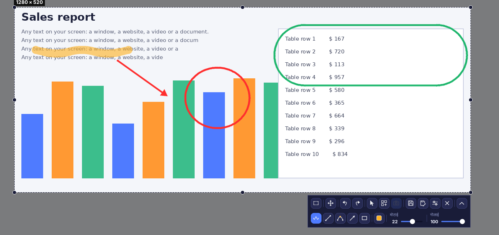
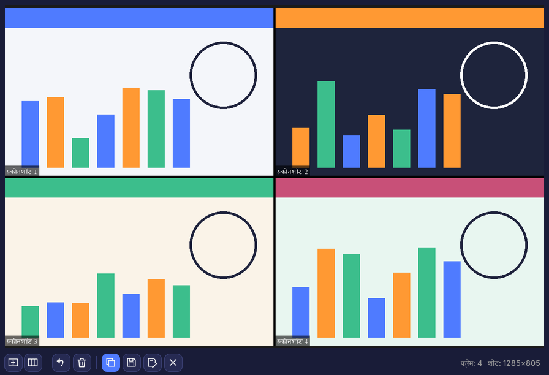
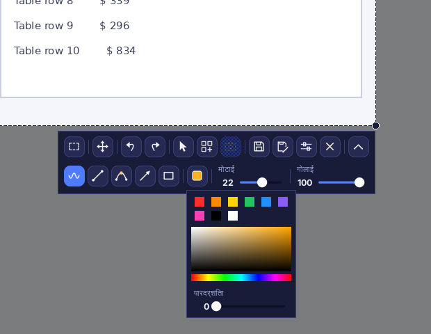
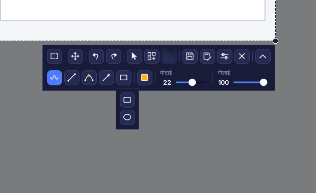
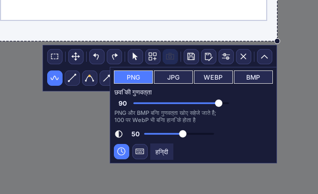
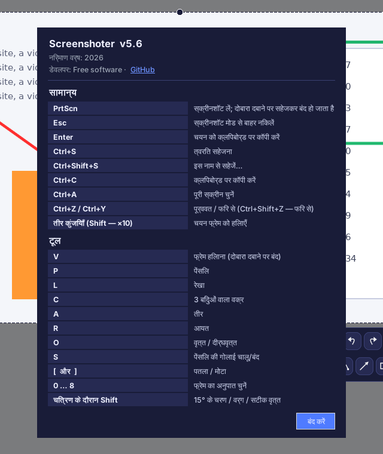

# Screenshoter (स्क्रीनशॉटर)

[English](README.md) · [Русский](README.ru.md) · [Español](README.es.md) · [Deutsch](README.de.md) · [Français](README.fr.md) · [Português](README.pt.md) · [中文](README.zh.md) · [日本語](README.ja.md) · **हिन्दी** · [العربية](README.ar.md)

**Screenshoter** Lightshot जैसा Windows के लिए तेज़ स्क्रीनशॉट प्रोग्राम है: **PrtScn** दबाएँ, क्षेत्र चुनें, उसके ऊपर तीर, फ़्रेम और टिप्पणियाँ बनाएँ, फिर सहेजें या कॉपी करें। आधुनिक डार्क इंटरफ़ेस, सिस्टम ट्रे में चलता है। इंटरफ़ेस 10 भाषाओं में उपलब्ध है।

## मुख्य सुविधाएँ

- **क्षेत्र चयन** — किनारों और कोनों पर हैंडल; फ़्रेम अपनी स्थिति याद रखता है।
- **अनुपात**: मुक्त, 1:1, 4:5, 3:4, 4:3, 16:9, 9:16, 3:2, 2:3, कस्टम अनुपात या पिक्सेल में सटीक आकार।
- **ड्रॉइंग**: पेंसिल, रेखा, 3 बिंदुओं वाला वक्र, तीर, आयत, वृत्त और दीर्घवृत्त; रंग, पारदर्शिता, मोटाई, गोलाई; पूर्ववत और फिर से।
- **माउस कर्सर** को स्क्रीनशॉट में शामिल किया जा सकता है।
- **सहेजना** PNG, JPG, WEBP और BMP में, गुणवत्ता के चयन के साथ; क्लिपबोर्ड पर कॉपी।
- **सहेजते समय कैप्चर**: स्क्रीन जमती नहीं, वीडियो चलता रहता है, चित्र सहेजने के क्षण लिया जाता है।
- **कोलाज**: कई फ़्रेम एक शीट पर — नीचे अलग अनुभाग देखें।
- कई मॉनिटर और Windows स्केलिंग 125–200 %।
- **10 इंटरफ़ेस भाषाएँ**: Русский, English, Español, Deutsch, Français, Português, 中文, 日本語, हिन्दी, العربية (सेटिंग्स में चुनें)।

## कोलाज मोड

स्क्रीन के कई हिस्सों को **एक शीट** पर इकट्ठा करें — ट्यूटोरियल, बग रिपोर्ट, पहले/बाद की तुलना या सोशल मीडिया पोस्ट के लिए। काम करते समय स्क्रीन चलती रहती है: आप पेज स्क्रॉल कर सकते हैं या वीडियो चलाते हुए फ़्रेम लेते रह सकते हैं।

1. स्क्रीनशॉट (**PrtScn**) खोलें, क्षेत्र चुनें और पैनल पर **कोलाज** बटन दबाएँ। स्क्रीन जमती नहीं — वह लाइव रहती है।
2. फ़्रेम को हिलाएँ या उसका आकार बदलें, फिर क्षेत्र कैप्चर करने के लिए **फ़्रेम** बटन (या **PrtScn** / **Enter**) दबाएँ। जितनी बार चाहें दोहराएँ।
3. कोलाज विंडो फ़्रेम को ग्रिड में जमाती है; हर फ़्रेम पर “स्क्रीनशॉट N” कैप्शन होता है और बीच में काली सीमाएँ होती हैं। **सेल का अनुपात** (स्वतः, 1:1, 16:9, कस्टम…) और **स्तंभों की संख्या** चुनें।
4. शीट **सहेजें** (PNG, JPG, WEBP, BMP), **इस नाम से सहेजें…**, क्लिपबोर्ड पर **कॉपी करें**, अंतिम फ़्रेम पूर्ववत करें, सब साफ़ करें, या विंडो छोटी करके कैप्चर जारी रखें।
5. कोलाज बटन से कोलाज मोड छोड़ने पर लिए गए फ़्रेम हटा दिए जाते हैं।

## इंटरफ़ेस

ऊपरी पंक्ति: अनुपात, फ़्रेम हिलाना, पूर्ववत और फिर से, चित्र में कर्सर, कोलाज, कोलाज फ़्रेम, सहेजें, इस नाम से सहेजें, सेटिंग्स, बंद करें। निचली पंक्ति (तीर बटन से खुलती है): पेंसिल, रेखा, वक्र, तीर, आकृतियाँ, रंग, मोटाई, गोलाई। कोई भी टूल अपने आप चालू नहीं होता; सक्रिय टूल को दोबारा दबाने पर वह बंद हो जाता है। क्रॉसहेयर केवल ड्रॉइंग के दौरान दिखता है।

### रंग और पारदर्शिता

त्वरित रंग, पैलेट और रेखा की पारदर्शिता का स्लाइडर।

### आकृतियाँ

### सेटिंग्स

प्रारूप और गुणवत्ता, फ़्रेम के बाहर अंधेरा, “सहेजते समय कैप्चर” (घड़ी), शॉर्टकट कुंजियाँ (कीबोर्ड) और भाषा का चयन।

### शॉर्टकट कुंजियाँ और जानकारी

## इंस्टॉलेशन

1. python.org से Python 3.9 या नया संस्करण इंस्टॉल करें (“Add Python to PATH” पर टिक करें)।
2. `install.bat` चलाएँ — यह Pillow, pystray, pynput और अरबी के लिए arabic-reshaper, python-bidi इंस्टॉल करता है।
3. `run.bat` चलाएँ। ट्रे में आइकन दिखेगा; स्क्रीनशॉट के लिए **PrtScn** दबाएँ।
4. Python के बिना चलने वाली एक `.exe` फ़ाइल के लिए `build_exe.bat` चलाएँ; परिणाम `dist` फ़ोल्डर में मिलेगा।

> ऑटोस्टार्ट: ट्रे आइकन पर राइट-क्लिक → “Windows के साथ शुरू करें”। Windows 11 में PrtScn डिफ़ॉल्ट रूप से Snipping Tool खोलता है: इसे सेटिंग्स → एक्सेसिबिलिटी → कीबोर्ड में बंद करें।

## डेवलपमेंट

Python 3, Tkinter, Pillow, pystray, pynput। स्रोत कोड — `screenshoter.py` और `i18n_data.py` (अनुवाद)।

निर्माण वर्ष: 2026। डेवलपर: Free software · [GitHub](https://github.com/Al235r/Screenshoter)।
