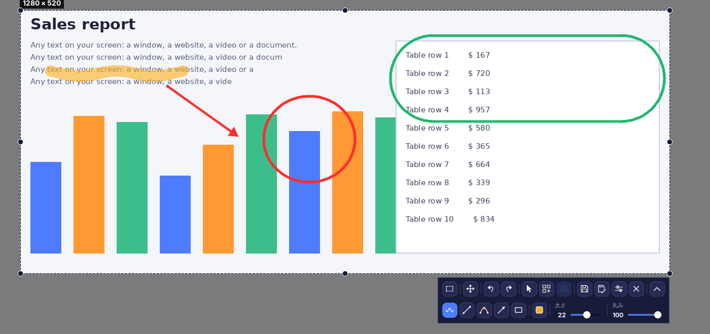
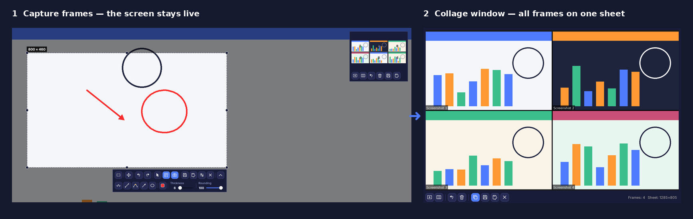
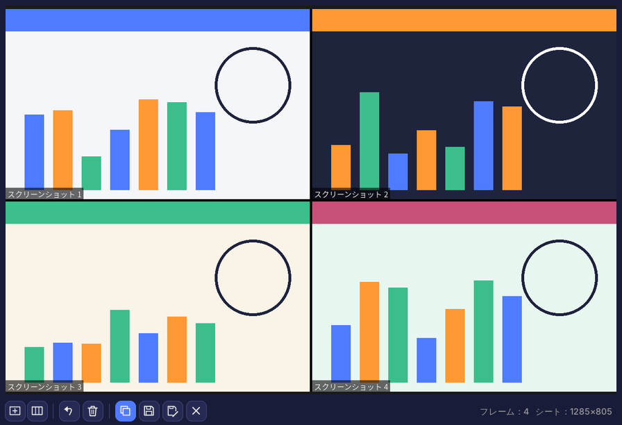
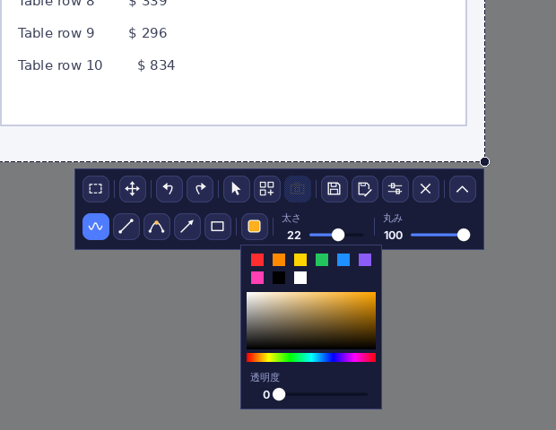
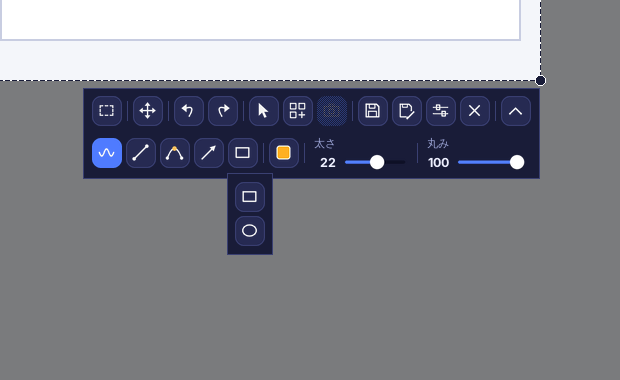
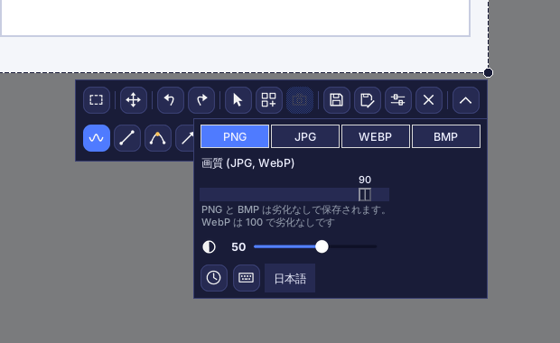
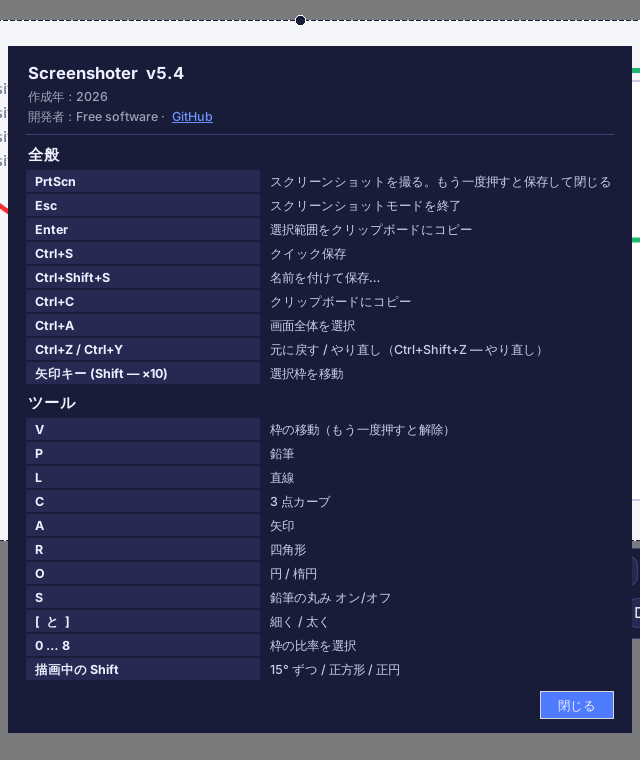

# Screenshoter（スクリーンショットツール）

[English](README.md) · [Русский](README.ru.md) · [Español](README.es.md) · [Deutsch](README.de.md) · [Français](README.fr.md) · [Português](README.pt.md) · [中文](README.zh.md) · **日本語** · [हिन्दी](README.hi.md) · [العربية](README.ar.md)

**Screenshoter** は Lightshot のような Windows 用の高速スクリーンショットツールです。**PrtScn** を押して範囲を選び、矢印や枠、メモを描き込み、保存またはコピーできます。モダンなダークデザインで、システムトレイに常駐します。画面は 10 言語に対応しています。

## 機能

- **範囲選択**：辺と角にハンドルがあり、枠の位置は記憶されます。
- **比率**：自由、1:1、4:5、3:4、4:3、16:9、9:16、3:2、2:3、任意の比率、またはピクセル単位の正確なサイズ。
- **描画**：鉛筆、直線、3 点カーブ、矢印、四角形、円と楕円。色・透明度・太さ・丸みを調整でき、元に戻す／やり直しも可能。
- **マウスカーソル**をスクリーンショットに含められます。
- PNG、JPG、WEBP、BMP で**保存**（画質調整可）。クリップボードへのコピーにも対応。
- **保存時にキャプチャ**：画面は固まらず、動画も再生され続け、保存した瞬間に撮影されます。
- **コラージュ**：ライブモード、「スクリーンショット N」のキャプション付きフレーム、黒い枠線、枠外の暗転。
- マルチモニターと Windows の拡大率 125〜200 % に対応。
- **10 言語の表示**：Русский、English、Español、Deutsch、Français、Português、中文、日本語、हिन्दी、العربية（設定で選択）。

## コラージュモード

画面の複数の部分を**1枚のシート**にまとめられます。チュートリアル、不具合報告、ビフォー／アフターの比較、SNS 投稿などに便利です。作業中も画面は動き続けるので、ページをスクロールしたり動画を再生しながら撮影を続けられます。

1. スクリーンショット（**PrtScn**）を開き、範囲を選んでツールバーの**コラージュ**ボタンを押します。画面は固まらず、そのまま動き続けます。
2. 枠を動かすかサイズを変えて、**フレーム**ボタン（または **PrtScn** / **Enter**）で範囲を撮影します。何度でも繰り返せます。
3. コラージュのウィンドウでは、各フレームが「スクリーンショット N」のキャプション付きでグリッド状に並び、黒い枠線で区切られます。**セルの比率**（自動、1:1、16:9、カスタム…）と**列数**を選べます。
4. シートを**保存**（PNG、JPG、WEBP、BMP）、**名前を付けて保存…**、クリップボードに**コピー**、直前のフレームを取り消し、すべて消去、またはウィンドウを最小化して撮影を続けます。
5. コラージュボタンでモードを終了すると、撮影したフレームは破棄されます。

## 画面構成

上段：比率、枠の移動、元に戻す／やり直し、カーソルの表示、コラージュ、コラージュのフレーム、保存、名前を付けて保存、設定、閉じる。下段（矢印ボタンで開閉）：鉛筆、直線、カーブ、矢印、図形、色、太さ、丸み。ツールが勝手にオンになることはなく、オンのツールをもう一度押すとオフになります。十字カーソルは描画中だけ表示されます。

### 色と透明度

クイックカラー、パレット、線の透明度スライダー。

### 図形

### 設定

形式と画質、枠外の暗さ、「保存時にキャプチャ」（時計）、ショートカットキー（キーボード）、言語の選択。

### ショートカットキーとバージョン情報

## インストール

1. python.org から Python 3.9 以降をインストールします（「Add Python to PATH」にチェック）。
2. `install.bat` を実行します。Pillow、pystray、pynput がインストールされます。
3. `run.bat` を実行します。トレイにアイコンが表示され、**PrtScn** で撮影できます。
4. Python 不要の単一 `.exe` が欲しい場合は `build_exe.bat` を実行します（結果は `dist` フォルダー）。

> 自動起動：トレイのアイコンを右クリック →「Windows と一緒に起動」。Windows 11 では PrtScn で Snipping Tool が開くため、設定 → アクセシビリティ → キーボード でオフにしてください。

## 開発

Python 3、Tkinter、Pillow、pystray、pynput。ソース：`screenshoter.py` と `i18n_data.py`（翻訳）。

作成年：2026。開発者：Free software · [GitHub](https://github.com/Al235r/Screenshoter)。
