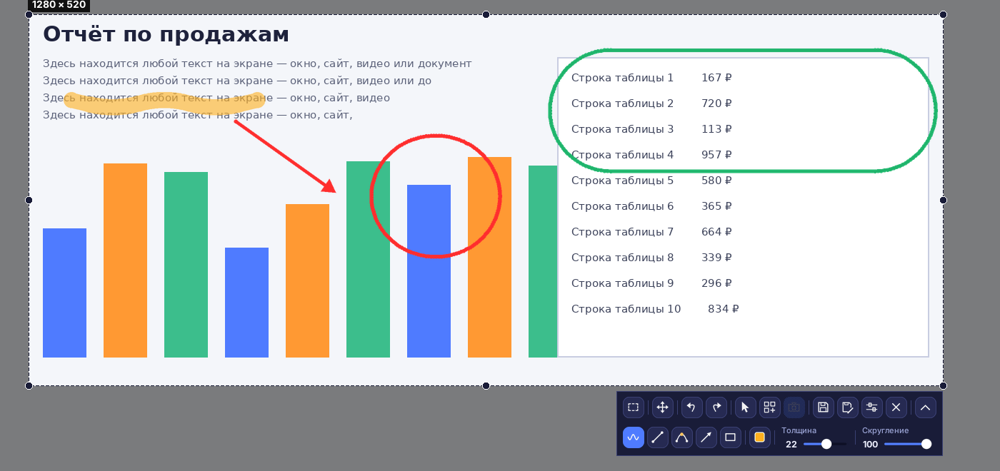
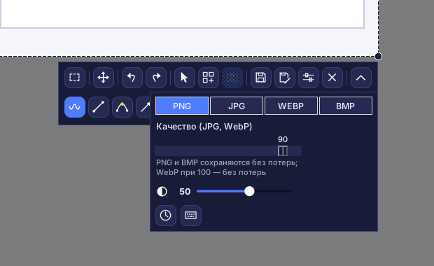
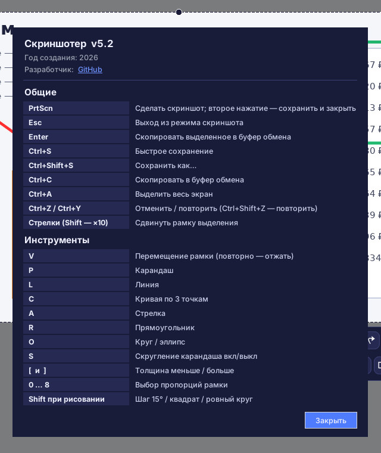

# Скриншотер (Screenshoter)

**Скриншотер** — быстрая программа для скриншотов под Windows в духе Lightshot: нажали **PrtScn**, выделили область, нарисовали поверх стрелки, рамки и пометки, сохранили или скопировали. Современный тёмный интерфейс, работает из системного трея (значок возле часов).

## Главное

- **Выделение области** с ручками по краям и углам; рамка запоминает своё положение между запусками.
- **Пропорции** рамки: свободно, 1:1, 4:5, 3:4, 4:3, 16:9, 9:16, 3:2, 2:3, своё соотношение (например 21:9) или точный размер в пикселях (1080x1350).
- **Рисование**: карандаш (со скруглением или с острыми углами), прямая линия, кривая по трём точкам, стрелка, прямоугольник, круг и эллипс.
- **Цвет и прозрачность** линии, **толщина** и **скругление** на ползунках, отмена и повтор действий.
- **Курсор мыши** можно включить в снимок (кнопка со стрелкой на панели).
- **Сохранение** одной кнопкой или «Сохранить как…» в форматах PNG, JPG, WEBP и BMP с выбором качества.
- **Копирование** в буфер обмена (Enter или Ctrl+C).
- **Снимок при сохранении** — экран не замораживается: видео и анимация продолжают идти, кадр берётся в момент сохранения.
- **Коллаж** — живой режим: нажимайте PrtScn и собирайте кадры в одно изображение. Кадры подписываются «Скриншот N», между ними чёрные границы, область вне рамки затемнена (степень затемнения настраивается).
- Работает с несколькими мониторами и масштабом Windows 125–200 %.

## Интерфейс

Верхний ряд панели: пропорции, перемещение рамки, отмена и повтор, курсор в снимке, коллаж, кадр коллажа, сохранить, сохранить как, настройки, закрыть. Нижний ряд (кнопка-стрелка справа раскрывает и скрывает его): карандаш, линия, кривая, стрелка, фигуры, цвет, толщина, скругление.

Ни один инструмент рисования не включается сам: выберите его на панели. Повторное нажатие на включённую кнопку выключает её, а выбор другой кнопки выключает предыдущую. Плюсик вместо курсора появляется только в момент рисования.

### Цвет и прозрачность

Быстрые цвета, палитра с любым оттенком и ползунок прозрачности линии.

### Фигуры

### Настройки

Формат и качество сохранения, степень затемнения вне рамки, режим «Снимок при сохранении» (значок часов) и окно горячих клавиш (значок клавиатуры).

### Горячие клавиши

## Установка

1. Установите Python 3.9 или новее с python.org (при установке отметьте «Add Python to PATH»).
2. Запустите `install.bat` — он поставит библиотеки Pillow, pystray и pynput.
3. Запустите `run.bat`. В трее появится значок, снимок делается клавишей **PrtScn**.

Чтобы получить один файл `.exe`, который работает без Python, запустите `build_exe.bat`, готовый файл появится в папке `dist`.

Автозапуск: правый клик по значку в трее → «Запускать вместе с Windows».

> В Windows 11 клавиша PrtScn по умолчанию открывает «Ножницы». Отключите это: Параметры → Специальные возможности → Клавиатура → «Использовать клавишу Print Screen для открытия функции снимка экрана».

## Разработка

Программа написана на Python 3 с Tkinter. Используются Pillow (отрисовка и сохранение), pystray (значок в трее) и pynput (глобальные клавиши). Исходный код — один файл `screenshoter.py`.

Год создания: 2026. Разработчик: [GitHub](https://github.com/Al235r/Screenshoter).
