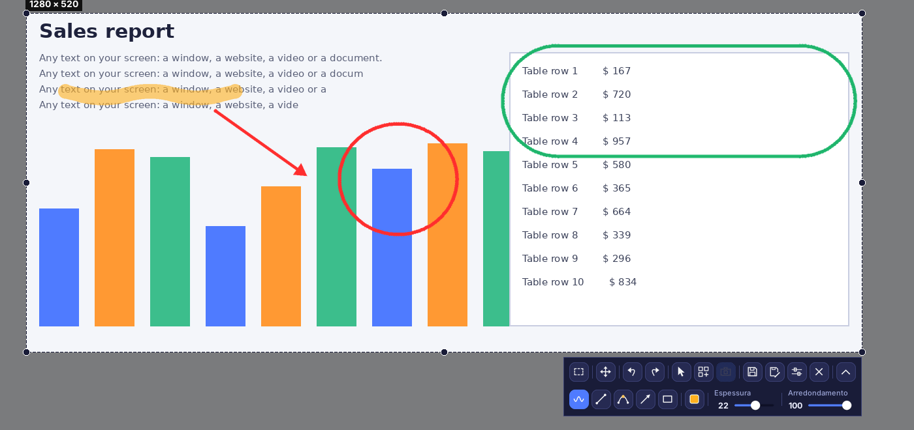
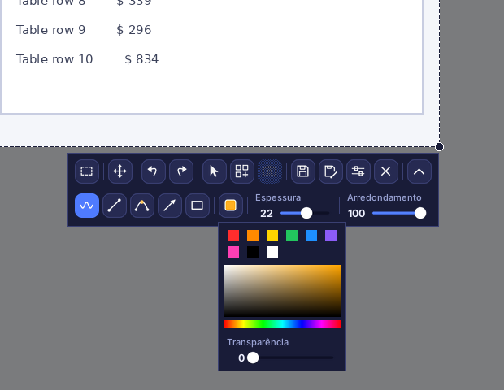
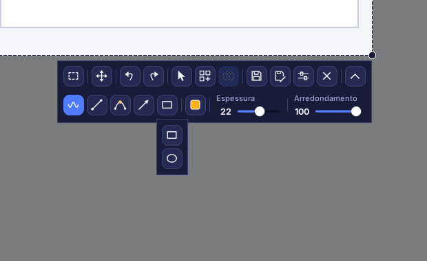
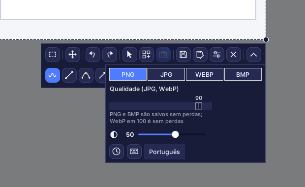
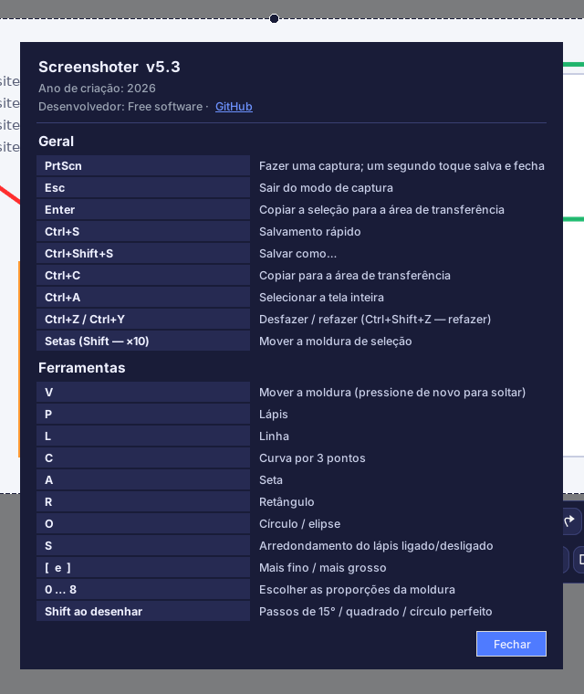

# Screenshoter

[Русский](README.md) · [English](README.en.md) · [Español](README.es.md) · [Deutsch](README.de.md) · [Français](README.fr.md) · **Português** · [中文](README.zh.md) · [日本語](README.ja.md)

**Screenshoter** é uma ferramenta rápida de capturas de tela para Windows no estilo do Lightshot: pressione **PrtScn**, selecione uma área, desenhe setas, molduras e anotações por cima e salve ou copie. Interface escura moderna, funciona na bandeja do sistema. A interface está disponível em 8 idiomas.

## Recursos

- **Seleção de área** com alças nas bordas e nos cantos; a moldura lembra a sua posição.
- **Proporções**: livre, 1:1, 4:5, 3:4, 4:3, 16:9, 9:16, 3:2, 2:3, uma proporção própria ou um tamanho exato em pixels.
- **Desenho**: lápis, linha, curva de 3 pontos, seta, retângulo, círculo e elipse; cor, transparência, espessura, arredondamento; desfazer e refazer.
- O **cursor do mouse** pode ser incluído na captura.
- **Salvamento** em PNG, JPG, WEBP e BMP com controle de qualidade; cópia para a área de transferência.
- **Captura ao salvar**: a tela não congela, o vídeo continua e a imagem é feita no momento de salvar.
- **Colagem**: modo ao vivo, quadros com a legenda “Captura N”, bordas pretas e escurecimento fora da moldura.
- Vários monitores e escala do Windows de 125 a 200 %.
- **8 idiomas de interface**: Русский, English, Español, Deutsch, Français, Português, 中文, 日本語 (escolha em Configurações).

## Interface

Linha superior: proporções, mover a moldura, desfazer e refazer, cursor na captura, colagem, quadro da colagem, salvar, salvar como, configurações, fechar. Linha inferior (exibida pelo botão de seta): lápis, linha, curva, seta, formas, cor, espessura, arredondamento. Nenhuma ferramenta liga sozinha; clicar de novo desliga. A mira aparece apenas durante o desenho.

### Cor e transparência

Cores rápidas, paleta e controle deslizante de transparência da linha.

### Formas

### Configurações

Formato e qualidade, escurecimento fora da moldura, “Captura ao salvar” (relógio), atalhos de teclado (teclado) e escolha do idioma.

### Atalhos de teclado e sobre

## Instalação

1. Instale o Python 3.9 ou mais recente em python.org (marque “Add Python to PATH”).
2. Execute `install.bat`: ele instala Pillow, pystray e pynput.
3. Execute `run.bat`. Um ícone aparece na bandeja; capture com **PrtScn**.
4. Para um único `.exe` sem Python, execute `build_exe.bat`; o resultado fica em `dist`.

> Inicialização automática: clique com o botão direito no ícone da bandeja → “Iniciar com o Windows”. No Windows 11, PrtScn abre a Ferramenta de Recorte por padrão: desative em Configurações → Acessibilidade → Teclado.

## Desenvolvimento

Python 3, Tkinter, Pillow, pystray, pynput. Código: `screenshoter.py` e `i18n_data.py` (traduções).

Ano de criação: 2026. Desenvolvedor: Free software · [GitHub](https://github.com/Al235r/Screenshoter).
