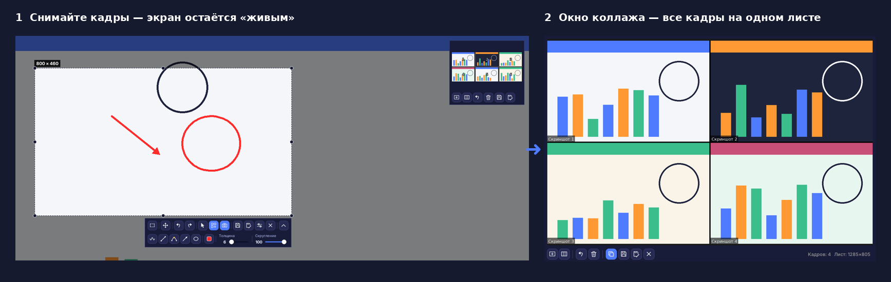
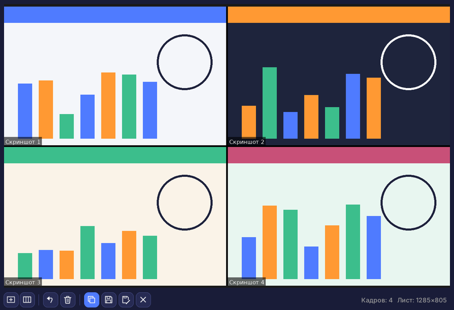
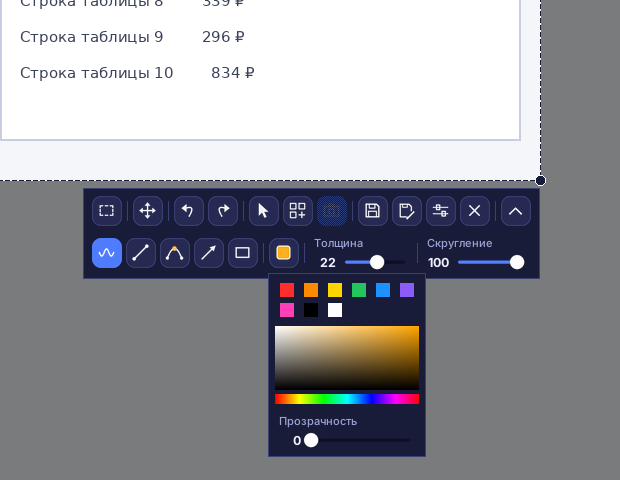
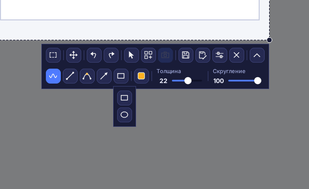
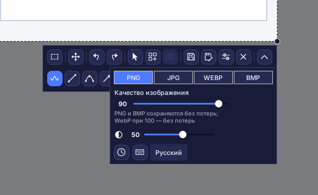
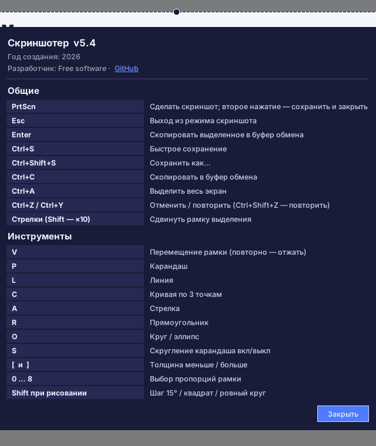

# Скриншотер (Screenshoter)

[English](README.md) · **Русский** · [Español](README.es.md) · [Deutsch](README.de.md) · [Français](README.fr.md) · [Português](README.pt.md) · [中文](README.zh.md) · [日本語](README.ja.md) · [हिन्दी](README.hi.md) · [العربية](README.ar.md)

**Скриншотер** — быстрая программа для скриншотов под Windows в духе Lightshot: нажали **PrtScn**, выделили область, нарисовали поверх стрелки, рамки и пометки, сохранили или скопировали. Современный тёмный интерфейс, работает из системного трея. Интерфейс на 10 языках.

## Главное

- **Выделение области** с ручками по краям и углам; рамка запоминает своё положение.
- **Пропорции** рамки: свободно, 1:1, 4:5, 3:4, 4:3, 16:9, 9:16, 3:2, 2:3, своё соотношение или точный размер в пикселях.
- **Рисование**: карандаш, линия, кривая по трём точкам, стрелка, прямоугольник, круг и эллипс; цвет, прозрачность, толщина, скругление; отмена и повтор.
- **Курсор мыши** можно включить в снимок.
- **Сохранение** в PNG, JPG, WEBP и BMP с выбором качества; копирование в буфер обмена.
- **Снимок при сохранении**: экран не замораживается, видео продолжает идти, кадр берётся в момент сохранения.
- **Коллаж**: живой режим, кадры с подписями «Скриншот N», чёрные границы, затемнение вне рамки.
- Несколько мониторов, масштаб Windows 125–200 %.
- **10 языков интерфейса**: русский, English, Español, Deutsch, Français, Português, 中文, 日本語, हिन्दी, العربية (выбор — в настройках).

## Режим коллажа

Соберите несколько фрагментов экрана на **одном листе** — для инструкции, отчёта об ошибке, сравнения «до/после» или поста. Экран остаётся живым: можно прокручивать страницу или смотреть видео и продолжать снимать кадры.

1. Откройте снимок (**PrtScn**), выделите область и нажмите кнопку **коллаж** на панели. Экран не замораживается — он остаётся «живым».
2. Подвиньте рамку или измените её размер и нажмите кнопку **кадр** (или **PrtScn** / **Enter**), чтобы снять область. Повторяйте сколько нужно.
3. Окно коллажа собирает кадры в сетку: у каждого подпись «Скриншот N», между кадрами чёрные границы. Выберите **пропорции ячейки** (авто, 1:1, 16:9, своё…) и **число столбцов**.
4. **Сохраните** лист (PNG, JPG, WEBP, BMP), «Сохранить как…», **скопируйте** в буфер, отмените последний кадр, очистите всё или сверните окно и продолжайте съёмку.
5. Выход из режима коллажа кнопкой коллажа удаляет снятые кадры.

## Интерфейс

Верхний ряд панели: пропорции, перемещение рамки, отмена и повтор, курсор в снимке, коллаж, кадр коллажа, сохранить, сохранить как, настройки, закрыть. Нижний ряд (раскрывается кнопкой-стрелкой): карандаш, линия, кривая, стрелка, фигуры, цвет, толщина, скругление. Ни один инструмент не включается сам; повторное нажатие на кнопку выключает инструмент. Плюсик вместо курсора — только во время рисования.

### Цвет и прозрачность

Быстрые цвета, палитра и ползунок прозрачности линии.

### Фигуры

### Настройки

Формат и качество, затемнение вне рамки, «Снимок при сохранении» (часы), горячие клавиши (клавиатура) и выбор языка.

### Горячие клавиши и о программе

## Установка

1. Установите Python 3.9 или новее с python.org (отметьте «Add Python to PATH»).
2. Запустите `install.bat` — он поставит Pillow, pystray и pynput.
3. Запустите `run.bat`. В трее появится значок, снимок — клавиша **PrtScn**.
4. Для одного файла `.exe` без Python запустите `build_exe.bat`, результат в папке `dist`.

> Автозапуск: правый клик по значку в трее → «Запускать вместе с Windows». В Windows 11 PrtScn по умолчанию открывает «Ножницы»: отключите это в Параметры → Специальные возможности → Клавиатура.

## Разработка

Python 3, Tkinter, Pillow, pystray, pynput. Исходный код — `screenshoter.py` и `i18n_data.py` (переводы).

Год создания: 2026. Разработчик: Free software · [GitHub](https://github.com/Al235r/Screenshoter).
