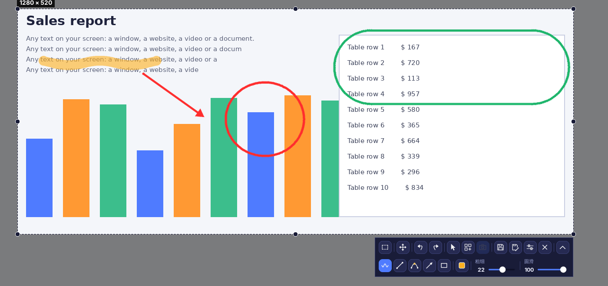
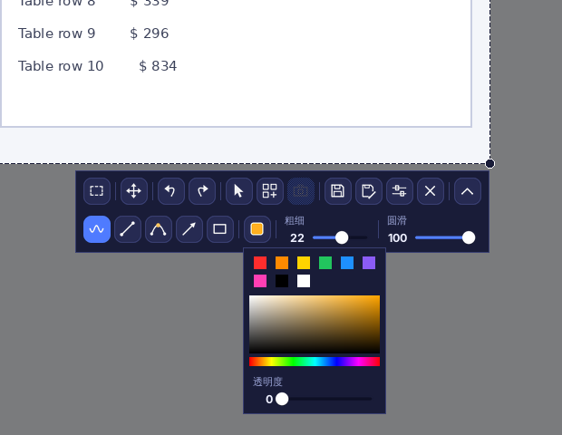
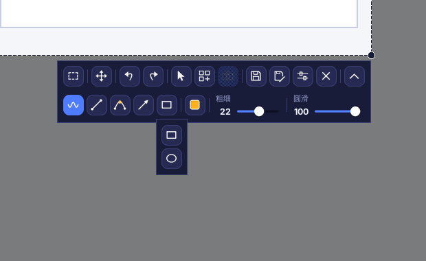
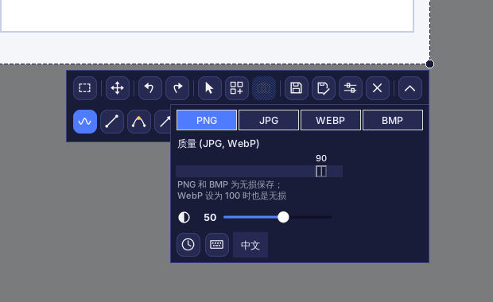
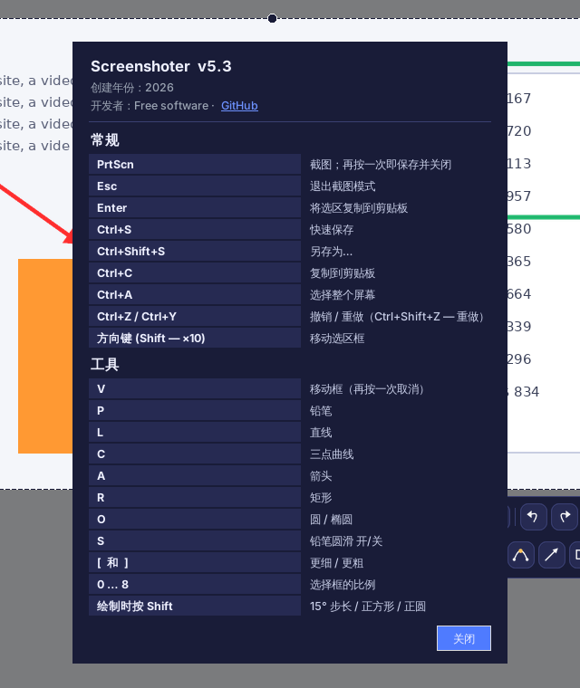

# Screenshoter（截图工具）

[Русский](README.md) · [English](README.en.md) · [Español](README.es.md) · [Deutsch](README.de.md) · [Français](README.fr.md) · [Português](README.pt.md) · **中文** · [日本語](README.ja.md)

**Screenshoter** 是一款类似 Lightshot 的 Windows 快速截图工具：按下 **PrtScn**，框选区域，在上面绘制箭头、边框和标注，然后保存或复制。现代深色界面，常驻系统托盘。界面支持 8 种语言。

## 功能

- **区域选择**：边缘和角落带有控制点，选框会记住自己的位置。
- **比例**：自由、1:1、4:5、3:4、4:3、16:9、9:16、3:2、2:3，也可自定义比例或精确像素尺寸。
- **绘图**：铅笔、直线、三点曲线、箭头、矩形、圆和椭圆；可调颜色、透明度、粗细、圆滑度；支持撤销与重做。
- 可将**鼠标光标**包含在截图中。
- **保存**为 PNG、JPG、WEBP 或 BMP，可调质量；可复制到剪贴板。
- **保存时截图**：屏幕不会冻结，视频继续播放，保存的瞬间才截取画面。
- **拼图**：实时模式，帧带有“截图 N”标注和黑色边框，框外变暗。
- 支持多显示器以及 125–200% 的 Windows 缩放。
- **8 种界面语言**：Русский、English、Español、Deutsch、Français、Português、中文、日本語（在设置中选择）。

## 界面

上排：比例、移动选框、撤销与重做、截图中的光标、拼图、拼图帧、保存、另存为、设置、关闭。下排（用箭头按钮展开）：铅笔、直线、曲线、箭头、形状、颜色、粗细、圆滑度。工具不会自动开启；再次点击已开启的工具即可关闭。只有在绘制时才显示十字光标。

### 颜色与透明度

快捷颜色、调色板和线条透明度滑块。

### 形状

### 设置

格式与质量、框外变暗、“保存时截图”（时钟图标）、快捷键（键盘图标）和语言选择。

### 快捷键与关于

## 安装

1. 从 python.org 安装 Python 3.9 或更高版本（勾选 “Add Python to PATH”）。
2. 运行 `install.bat`，它会安装 Pillow、pystray 和 pynput。
3. 运行 `run.bat`。托盘中会出现图标，按 **PrtScn** 截图。
4. 若需无需 Python 的单个 `.exe`，运行 `build_exe.bat`，结果在 `dist` 文件夹。

> 开机自启：右键托盘图标 →“随 Windows 启动”。Windows 11 默认用 PrtScn 打开截图工具，请在 设置 → 辅助功能 → 键盘 中关闭。

## 开发

Python 3、Tkinter、Pillow、pystray、pynput。源代码：`screenshoter.py` 和 `i18n_data.py`（翻译）。

创建年份：2026。开发者：Free software · [GitHub](https://github.com/Al235r/Screenshoter)。
